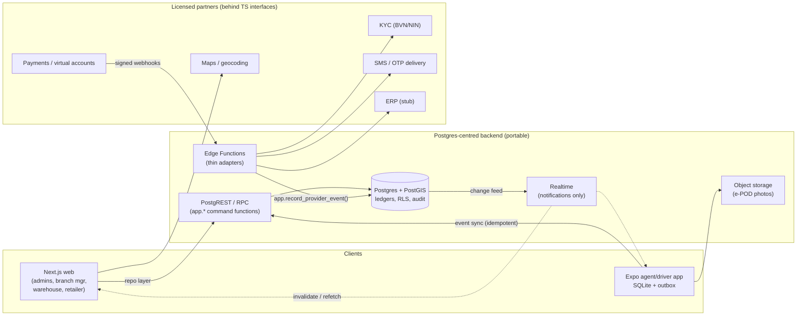
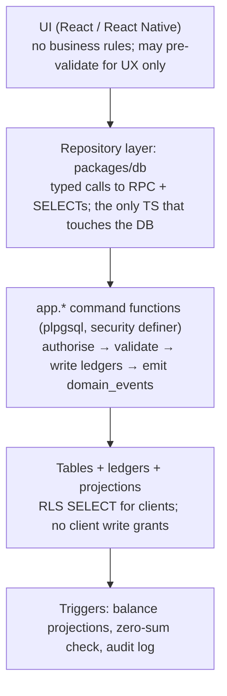

# Architecture overview

| Doc | Contents |
|---|---|
| [roles-permissions.md](roles-permissions.md) | Tenancy model, role × action matrix, RLS scoping |
| [domain-model.md](domain-model.md) | Entities, stock ledger semantics, chart of accounts, state machines, UoM, rounding |
| [flows.md](flows.md) | Sequence diagrams: pull, push, credit purchase, return + reconciliation, offline sync, payment webhook |
| [events.md](events.md) | Domain events and the agent sync envelope |
| [risk-register.md](risk-register.md) | Risks, mitigations, owning phase |
| [../adr/](../adr/README.md) | Architecture decision records |

## System context



## Layering



Rules that follow from this (also in [CLAUDE.md](../../CLAUDE.md)):

1. **Business logic lives in Postgres.** Moving off Supabase means moving SQL, not rewriting rules.
2. **Clients never write tables directly.** Each mutation is a single `app.*` function call, one transaction,
   all-or-nothing. Clients hold `EXECUTE` on those functions and RLS-scoped `SELECT` on tables, and nothing
   else.
3. **Edge Functions are adapters.** A webhook receiver verifies the signature, then calls
   `app.record_provider_event(...)`. Idempotency and ledger posting happen in SQL.
4. **Realtime is a hint.** Clients refetch through the repository layer on a notification. Nothing trusts a
   Realtime payload as state.
5. **One identity seam.** `app.current_user_id()` is the only caller of `auth.uid()`
   ([ADR-0004](../adr/0004-auth-abstraction-and-portability.md)).
6. **Every external service sits behind an interface** in `packages/integrations` with a mock and contract
   tests. Real adapters run server-side only (Edge Functions), never in clients.

## Database schemas
| Schema | Contents | Client access |
|---|---|---|
| `public` | business tables, ledgers, projections, read views | RLS `SELECT` only |
| `app` | command functions, auth helpers, `round_div`, routing | `EXECUTE` on command functions only |
| `audit` | `audit_log` (append-only) | none (platform admin reads via a function) |
| `private` | OTP hashes, provider secrets references, sync internals | none |

## Monorepo layout (npm workspaces)
```
apps/web               Next.js (App Router), role-based route groups
apps/agent             Expo RN; expo-sqlite store + outbox; event sync client
packages/core          types (Kobo, Pieces, Uuid), UoM conversion, money formatting (no I/O)
packages/db            repository layer over supabase-js (swappable to plain pg/HTTP)
packages/integrations  interfaces + mocks + contract tests (payments, kyc, sms, erp, maps, stubs)
supabase/migrations    ordered plain SQL
supabase/seed.sql      1 manufacturer, 2 distributors, 3 warehouses, 5 agents, 20 retailers, 15 SKUs
supabase/tests         pgTAP: RLS, invariants, ledger, OTP, sync idempotency
tests/concurrency      Node pg Pool: 50 parallel reservations vs 10 units
```

## Offline model (agent app)
- The local SQLite holds a **read cache** (catalogue, assigned retailers, last-known carried stock) and an
  **outbox** of events with client-generated UUIDs and a per-device monotonic `seq`.
- The device never computes authoritative balances. It shows "carried (server) − pending sales (local)" as
  an estimate.
- Sync is push-outbox-then-pull. Each event's result (`accepted | rejected | duplicate`) is written back
  locally. Rejected events show in the app **and** in the manager's review queue.
- Credit sales need connectivity (credit limit + OTP are server-side). See [ADR-0003](../adr/0003-ledger-design.md).
