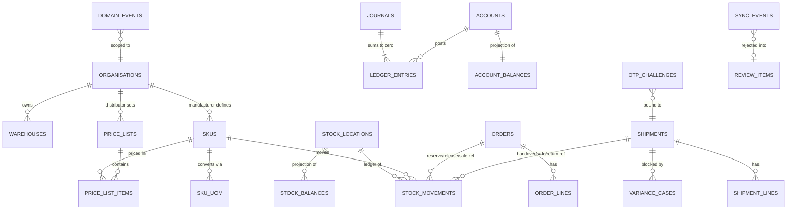
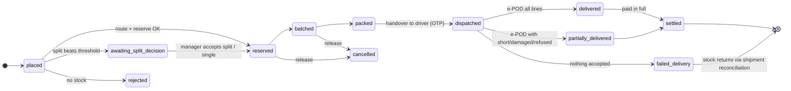
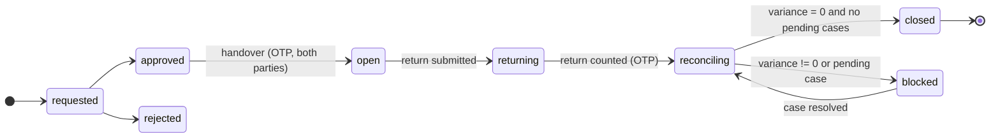

# Domain model

Detailed reasoning for the ledger choices is in [ADR-0003](../adr/0003-ledger-design.md). This doc is the
reference for **what** each table, movement and journal means.

## Core entities



| Table | Purpose | Mutability |
|---|---|---|
| `skus`, `brands`, `sku_uom` | master catalogue. `sku_uom(sku_id, uom_code, pieces_per_uom int > 0)`. `piece` = 1 always | versioned updates, audited |
| `skus.item_class` | `sellable` now; `returnable_container` reserved for empties | |
| `price_lists`, `price_list_items` | distributor price per `(sku, uom)` in kobo; effective-dated | new rows, never overwrite past prices |
| `stock_locations` | `(id, kind ∈ warehouse\|agent\|driver, org_id, ref_id)`. One row per warehouse / field person | static |
| `stock_movements` | **inventory ledger** | append-only |
| `stock_balances` | projection `(location_id, sku_id) → on_hand, reserved` | trigger-only |
| `orders`, `order_lines` | pull orders; `order_kind ∈ pull\|primary(deferred)` | state via commands |
| `shipments`, `shipment_lines` | one custody run: `kind ∈ push\|delivery`, carrier location, lines | state via commands |
| `transfers` | warehouse↔warehouse transfer header | state via commands |
| `variance_cases` | unresolved discrepancy holding a shipment open | state via commands |
| `accounts` | `(book_org_id, account_type, holder_org_id?, counterparty_id?)` | static |
| `journals`, `ledger_entries` | **money ledger** | append-only |
| `account_balances` | projection | trigger-only |
| `otp_challenges` (`private`) | hashed OTPs bound to a subject + 2 parties | state via commands |
| `sync_events`, `review_items` | agent event inbox + manager review queue | append-only inbox; review state via commands |
| `provider_events` | raw verified webhook payloads keyed by `(provider, provider_ref)` | append-only |
| `domain_events` | outbox for notifications / Realtime | append-only |
| `audit.audit_log` | row-level audit of every business table | append-only, enforced by trigger |

## Units of measure
- Stored and moved quantity is always **pieces** (`int`, > 0 on every movement row).
- `sku_uom` is applied only at input (cartons → pieces) and display (pieces → "3 ctn + 4 pcs").
- Order lines keep `qty_pieces` (authoritative for stock) **and** the pricing `uom_code` + `uom_qty` +
  `uom_price_kobo`. That lets a carton be priced exactly (₦5,000 per 24) without a fractional piece price.
  Line amount = `uom_qty × uom_price_kobo`, which is exact.
- When a carton-priced line is partially delivered, the refund/credit is
  `app.round_div(line_amount × delivered_pieces, ordered_pieces, 'half_even')`. This is the only rounding
  in the pricing path.

## Inventory ledger: `stock_movements`

Columns: `id uuid`, `movement_group_id uuid` (all legs of one business action), `movement_type`,
`location_id`, `sku_id`, `qty int CHECK (qty > 0)`, `on_hand_delta int`, `reserved_delta int`,
`ref_kind` + `ref_id` (order / shipment / transfer / adjustment / variance_case), `reason text`,
`batch_id uuid NULL`, `expiry_date date NULL`, `actor_user_id`, `occurred_at` (device or server time),
`recorded_at` (server `now()`), `idempotency_key text UNIQUE NULL`.

A `CHECK` constraint ties the deltas to the type, so a row can't claim to be a `sale` while adding stock.

| Type | Location kinds | Δ on_hand | Δ reserved | Legs / pairing | Required ref |
|---|---|---|---|---|---|
| `receipt` | warehouse | +q | 0 | single | receipt doc (later `primary` order) |
| `reserve` | warehouse | 0 | +q | single | order |
| `release` | warehouse | 0 | −q | single | order |
| `transfer_out` | warehouse | −q | 0 | single; paired with `transfer_in` **across transactions** by `transfer_id` | transfer |
| `transfer_in` | warehouse | +q | 0 | single | transfer |
| `handover` | warehouse → agent/driver | −q at source, +q at carrier | 0 | **2 legs, one transaction**, OTP-verified | shipment |
| `sale` | agent / driver | −q | 0 | single | shipment + order or sync event |
| `return` | agent/driver → warehouse | −q at carrier, +q at warehouse | 0 | **2 legs, one transaction**, OTP-verified | shipment |
| `damage` | any | −q | 0 | single | damage report (shipment / transfer / order) |
| `adjustment` | any | ±q (sign in `on_hand_delta`) | 0 | single | approved adjustment request **or** variance case |

Rules:
1. **Pull dispatch** is one movement group: `release q` + `handover −q` (warehouse) + `handover +q` (driver).
   Reserved stock never leaves without being released in the same transaction.
2. **Transfers** between warehouses go `transfer_out` at dispatch and `transfer_in` at receipt. In-transit =
   Σout − Σin − Σdamage for that transfer, exposed by a view. A transfer can't close until in-transit = 0.
3. **One open shipment per carrier location** (MVP). The carrier's `stock_balances` row then *is* the
   shipment balance, which keeps reconciliation exact.
4. Reserved stock exists only at warehouses (`reserved = 0` at agent/driver locations, enforced by CHECK).

### `stock_balances` projection
- PK `(location_id, sku_id)`; `CHECK (on_hand >= 0 AND reserved >= 0 AND reserved <= on_hand)`.
- Maintained by an `AFTER INSERT` trigger on `stock_movements` (upsert + delta), in the same transaction.
  If the CHECK fails, the whole command rolls back, so negative stock and oversell are impossible at the
  database level even if function logic is wrong.
- Clients: `SELECT` via RLS only. No role has INSERT/UPDATE/DELETE except the trigger owner.
- `available = on_hand − reserved` (generated column).
- Test (Phase 2): truncate-and-rebuild into a temp table from `stock_movements` and assert equality with the
  live projection.

### Reservation (`app.reserve_order`)
1. Lock candidate rows: `SELECT … FROM stock_balances WHERE location_id = ANY(:warehouses) AND sku_id = ANY(:skus)
   ORDER BY location_id, sku_id FOR UPDATE`. The fixed lock order prevents deadlocks.
2. Re-check `available` under the lock, choose a warehouse (routing below), insert `reserve` rows.
3. If any line can't be covered, raise. The transaction aborts and nothing is reserved.
4. Required test: 50 parallel connections each reserving 1 of 10 units → exactly 10 succeed, 40 fail cleanly,
   final `reserved = 10`, `on_hand = 10`.

### Pull routing (`app.route_order`)
- Candidates: warehouses of the serving distributor whose branch covers the retailer's territory, ordered by
  `ST_Distance(warehouse.geog, retailer.geog)`.
- Default: the **nearest warehouse that can cover the whole order**. If its distance exceeds the nearest
  warehouse's distance by more than `distributors.split_threshold_km` (configurable), the order goes to
  `awaiting_split_decision` with a proposed split.
- Stored on the order: `routing_decision jsonb` (candidates with distance + availability snapshot, choice,
  rule applied) and `routing_reason text`.

## Money ledger: books, accounts, journals

**Scope:** this is a sub-ledger of *funds and claims*, not a full general ledger. Inventory valuation and
COGS belong in the ERP (stubbed). The money ledger never holds a stock value.

### Books
Every entry belongs to a **book** (`book_org_id`):
- **Platform mirror book** (the platform org): mirrors funds held at the licensed partner. The platform
  owns no funds. This book exists so `provider_clearing` can be reconciled against partner statements.
- **Distributor book** (one per distributor): that distributor's receivables, credit, cash with agents,
  variance and revenue.

**Invariant:** the entries of a journal sum to zero **per book** (therefore also in total). It's checked by a
deferred constraint trigger at commit.

### Sign convention
`amount_kobo bigint`, **debit = positive, credit = negative**. Displayed balance =
`Σ amount × (normal_side = debit ? 1 : −1)`.

### Chart of accounts
| Account type | Book | Holder / counterparty | Normal | Meaning |
|---|---|---|---|---|
| `provider_clearing` | platform | partner | debit | funds at the licensed partner (mirror) |
| `wallet` | platform | holder org (retailer or distributor) | credit | that org's spendable funds at the partner |
| `partner_funds` | distributor | – | debit | distributor's own view of its `wallet`. Cross-book invariant: equals the platform `wallet[D]` balance |
| `receivables` | distributor | counterparty (retailer or agent) | debit | owed to the distributor, not under a credit facility |
| `trade_credit` | distributor | retailer | debit | drawn distributor-extended credit. Limit-checked, OTP-gated |
| `cash_in_transit` | distributor | agent/driver | debit | cash collected in the field, not yet remitted |
| `variance` | distributor | agent/driver | debit | **pending** discrepancy against a field person |
| `variance_offset` | distributor | – | credit | offset to `variance` while a case is pending |
| `sales_revenue` | distributor | – | credit | revenue recognised on sale / delivery |

### Journal catalogue (each row = one journal; ✓ = zero-sum per book)
| Journal | Entries | When |
|---|---|---|
| `va_inflow` | P: Dr `provider_clearing` / Cr `wallet[R]` | verified webhook, idempotent on `(provider, ref)` |
| `delivery_invoiced` | D: Dr `receivables[R]` / Cr `sales_revenue` | e-POD confirmed, **delivered qty** × price |
| `settle_wallet` | P: Dr `wallet[R]` / Cr `wallet[D]`; D: Dr `partner_funds` / Cr `receivables[R]` | retailer pays from wallet |
| `settle_credit` | D: Dr `trade_credit[R]` / Cr `receivables[R]` | retailer draws credit (limit lock + OTP) |
| `split_payment` | `settle_wallet` legs + `settle_credit` legs in **one** journal | wallet + credit checkout |
| `cash_collected` | D: Dr `cash_in_transit[A]` / Cr `receivables[R]` (pull) or Cr `sales_revenue` (push cash sale) | driver/agent records cash |
| `cash_remitted` | P: Dr `provider_clearing` / Cr `wallet[D]`; D: Dr `partner_funds` / Cr `cash_in_transit[A]` | agent pays into the distributor VA |
| `credit_repaid` | P: Dr `wallet[R]` / Cr `wallet[D]`; D: Dr `partner_funds` / Cr `trade_credit[R]` | retailer repays credit |
| `variance_raised` | D: Dr `variance[A]` / Cr `variance_offset` | reconciliation finds a gap (valued at the agent price list) |
| `variance_charged` | D: Dr `variance_offset` / Cr `variance[A]`; Dr `receivables[A]` / Cr `sales_revenue` | manager charges the agent |
| `variance_written_off` | D: Dr `variance_offset` / Cr `variance[A]` | manager approves write-off (the stock loss shows in the stock ledger `adjustment`) |
| `reversal` | negation of a prior journal, `reverses_journal_id` set | corrections (never UPDATE) |

Every journal has `idempotency_key UNIQUE NOT NULL`. A replay returns the original journal id and posts
nothing.

**Credit limit:** `app.draw_credit` locks the `customer_relationships` row `FOR UPDATE`, then checks
`balance(trade_credit[D,R]) + amount ≤ credit_limit_kobo` under the lock. That serialises concurrent draws
exactly like stock reservation.

## Reconciliation identity (push and delivery shipments)
```
picked_up = Σ handover(+) to carrier for the shipment
sold      = Σ sale
returned  = Σ return(−) from carrier
damaged   = Σ damage at carrier
adjusted  = Σ adjustment at carrier (variance resolutions, accept-into-variance)
variance  = picked_up + adjusted − sold − returned − damaged      (= carrier on_hand, by rule 3)
```
`app.close_shipment` raises unless `variance = 0` for every SKU **and** no `variance_cases` are `pending`.
A partial unique index blocks a second open shipment per carrier.

Worked example (push): 100 picked up, 70 sold, 25 returned, 3 damaged → carrier on_hand = 2 →
`variance_case(2 pcs, pending)` + `variance_raised` journal → shipment can't close → manager approves
write-off → `adjustment −2` + `variance_written_off` → on_hand 0, case closed → close succeeds.

## State machines





| Machine | States |
|---|---|
| `variance_cases` | `pending` → `charged_to_agent` \| `written_off` \| `linked_to_handover` (all terminal, resolver ≠ shipment carrier) |
| `otp_challenges` | `issued` → `verified` \| `expired` \| `locked` (max attempts) \| `superseded` (re-issued) |
| `sync_events` | `received` → `accepted` \| `duplicate` \| `rejected` |
| `review_items` | `open` → `accepted` (re-applied) \| `accepted_into_variance` \| `dismissed` (reason required) |

## OTP binding (`private.otp_challenges`)
`id, purpose ∈ handover|return|credit, subject_kind, subject_id, initiator_user_id, recipient_user_id,
code_hash (bcrypt via pgcrypto crypt()), expires_at (default now()+5 min), attempts, max_attempts (5),
status, verified_at`.
`app.verify_otp(challenge_id, code)` checks the caller is the `initiator_user_id`, the subject is still in
the expected state, not expired, not locked. A wrong code increments `attempts` and **returns** a failure
result instead of raising. Postgres has no autonomous transactions, so raising would roll the increment
back and allow free retries. On success it performs the bound action in the **same transaction**. The code is generated server-side and delivered only through `SmsProvider`. It is never
returned to any client.

## Rounding: `app.round_div(numerator bigint, denominator bigint, mode text) → bigint`
- Modes: `half_even` (default), `half_up` (away from zero), `floor`, `ceil`. Unknown mode → error.
  Denominator ≤ 0 → error. Overflow → error (no silent wrap).
- Basis-point fees: `round_div(amount_kobo * bps, 10000, mode)`. Overflow is checked before multiplying.
- Tested exhaustively at .5 boundaries, negatives and extremes in pgTAP. A TS mirror in `packages/core`
  exists **only** for display previews and is contract-tested against the SQL.
