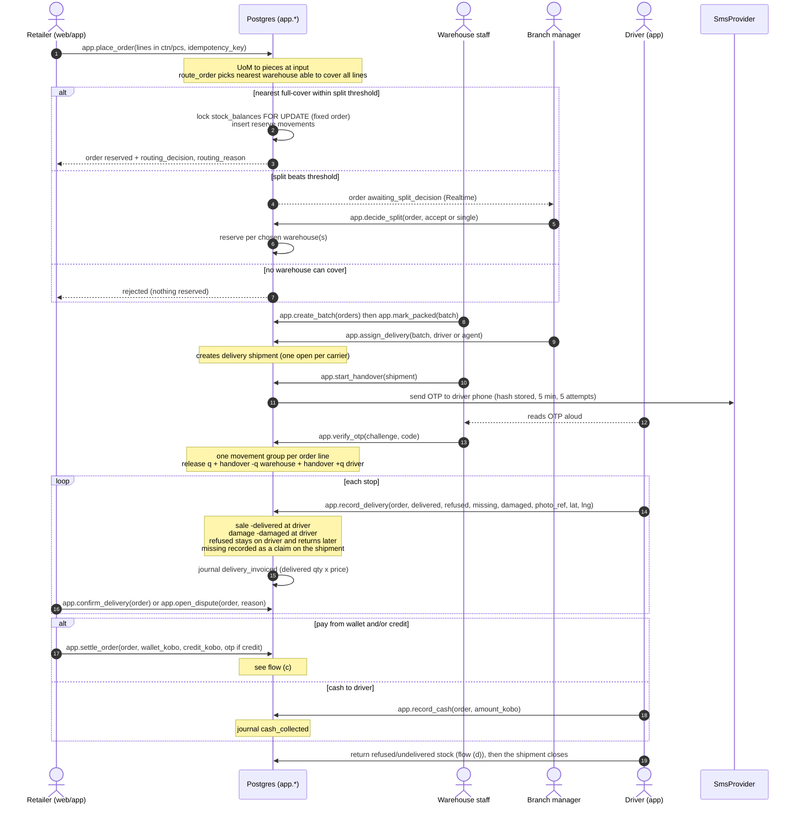
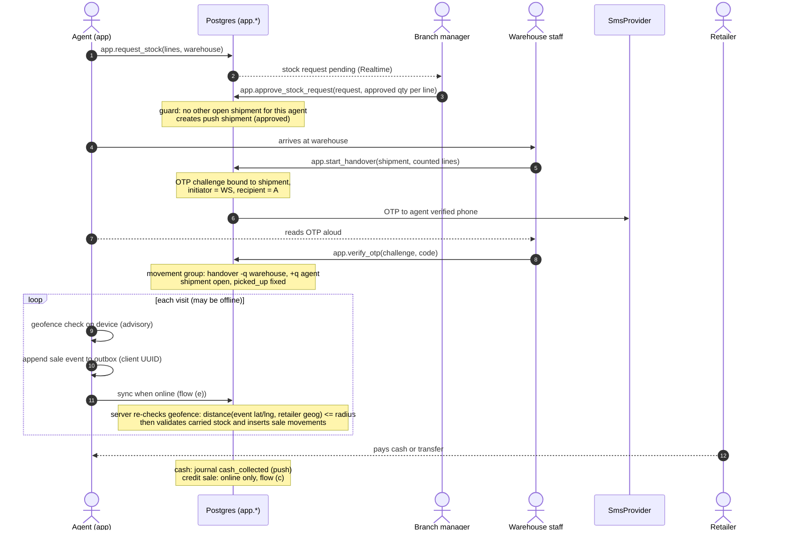
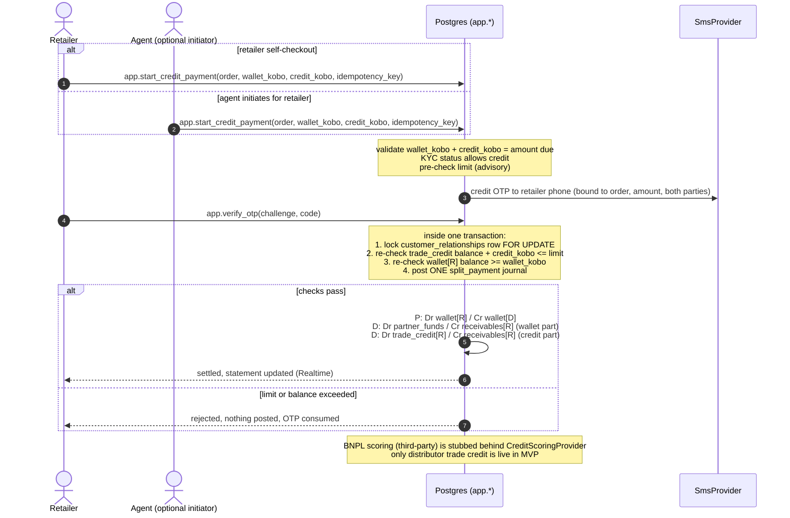
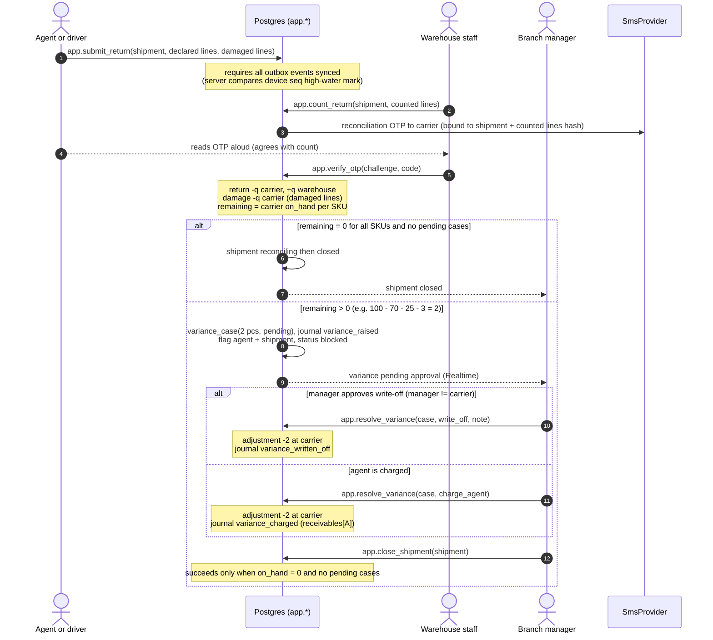
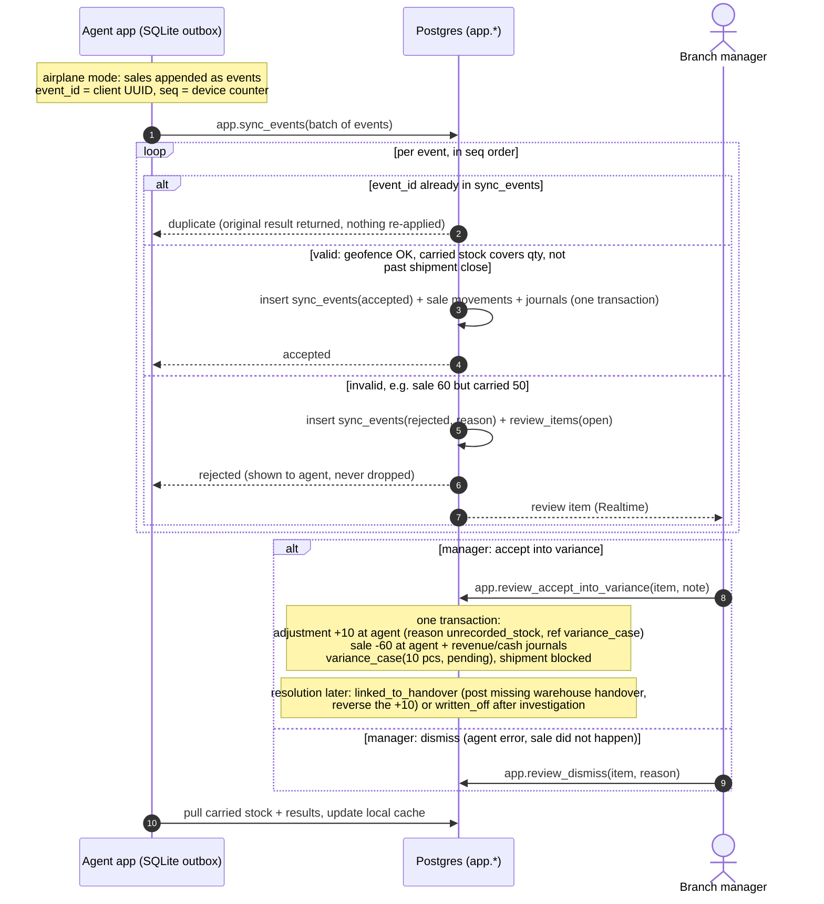
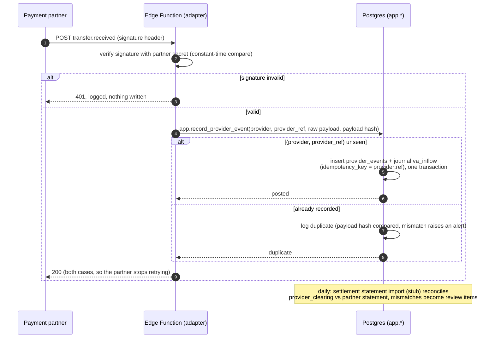

# Flows

Every box labelled `app.*` is one Postgres function call = one transaction. Ledger effects use the names in
[domain-model.md](domain-model.md). Realtime arrows are notifications only, and clients refetch on them.

## (a) Pull order: order → route → reserve → fulfil → deliver → pay

## (b) Push: request → approve → OTP handover → geofenced sales

## (c) Credit purchase: split wallet + trade credit, credit OTP

## (d) Return + reconciliation (push shipments and delivery runs)

## (e) Offline sync, rejection → review queue → accept-into-variance

## (f) Payment webhook (virtual-account inflow), duplicate-safe

