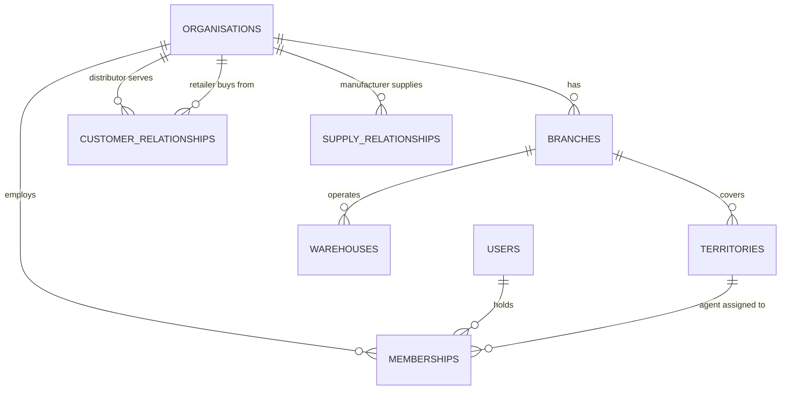

# Roles, tenancy and permissions

## Tenancy model

- `organisations.kind` ∈ `platform | manufacturer | distributor | retailer`. A retailer is an organisation
  (usually one shop, one user), which keeps its wallet and credit accounts owned by an org like everyone else.
- `memberships(user_id, org_id, role, branch_id?, territory_id?, status)`. A user may hold several
  memberships (rare, but supported). The **active membership** is picked at login and carried in the session.
  Every `app.*` function re-checks it server-side.
- `customer_relationships(distributor_org_id, retailer_org_id, territory_id, credit_limit_kobo, status)` says
  which distributors a retailer may order from and holds the distributor-extended credit limit.
- `supply_relationships(manufacturer_org_id, distributor_org_id)` scopes catalogue visibility and
  manufacturer reporting.

## RLS scoping primitives (all `security definer`, `search_path = ''`, `STABLE`)
| Helper | Returns |
|---|---|
| `app.current_user_id()` | the authenticated user's uuid (sole wrapper of `auth.uid()`) |
| `app.current_org_ids()` | org ids where the user has an active membership |
| `app.has_role(org_id, role[])` | boolean |
| `app.current_branch_ids(org_id)` | branches the user is scoped to (all branches for org-wide roles) |
| `app.is_platform_admin()` | boolean |

Policies use the form `org_id = any((select app.current_org_ids()))`, with an index on every policy column.

## Scope legend
`P` platform-wide · `M` manufacturer (own catalogue + **aggregates** of supplied distributors, no retailer PII) ·
`D` own distributor org · `B` own branch(es) · `T` own territory · `O` own records only · `–` none

## Permission matrix

| Capability | Platform admin | Manufacturer admin | Distributor admin | Branch manager | Warehouse staff | Driver | Agent | Retailer |
|---|---|---|---|---|---|---|---|---|
| Onboard / suspend manufacturer, distributor orgs | P | – | – | – | – | – | – | – |
| Invite staff, assign roles | P | M (own org) | D | B (staff below BM) | – | – | – | – |
| Approve retailer / agent registration | P (read) | – | D | B | – | – | – | – |
| Submit KYC; view KYC **status** | P | – | D (status only) | B (status only) | – | – | – | O (submit) |
| Manage branches, territories, warehouses | P | – | D | B (read) | B (read) | – | T (read) | – |
| Master catalogue: brands, SKUs, `sku_uom` | P (read) | M | D (read) | B (read) | B (read) | read | read | read |
| Distributor price lists | – | – | D | B (read) | – | – | read | read (own distributors) |
| View stock balances | P | M (aggregates) | D | B | B | O (vehicle) | O (carried) | – |
| Record receipt (inbound stock) | – | – | D | B | B | – | – | – |
| Request adjustment | – | – | D | B | B | – | – | – |
| Approve adjustment (**not own request**) | – | – | D | B | – | – | – | – |
| Create transfer warehouse ↔ warehouse | – | – | D | B | – | – | – | – |
| Dispatch / receive transfer | – | – | – | – | B | – | – | – |
| Place pull order | – | – | – | – | – | – | T (on behalf, retailer confirms) | O |
| View orders | P | M (aggregates) | D | B | B (fulfilment fields) | O (assigned) | T | O |
| Override routing / approve split | – | – | D | B | – | – | – | – |
| Batch, pick, pack | – | – | – | – | B | – | – | – |
| Assign delivery (driver or agent) | – | – | D | B | – | – | – | – |
| Capture e-POD, photo, partial/missing/damaged | – | – | – | – | – | O (assigned) | O (assigned) | confirm/dispute O |
| Agent stock request (push) | – | – | – | – | – | – | O | – |
| Approve / reject stock request | – | – | D | B | – | – | – | – |
| Handover: initiate (staff side) | – | – | – | – | B | – | – | – |
| Handover: confirm with OTP (receiver side) | – | – | – | – | – | O | O | – |
| Record sale (incl. offline events) | – | – | – | – | – | O (delivery) | O | – |
| Return unsold stock: submit | – | – | – | – | – | O | O | – |
| Return: receive + count (OTP) | – | – | – | – | B | – | – | – |
| Close shipment | – | – | D | B | – | – | – | – |
| Approve variance write-off (**not own shipment**) | – | – | D (any amount) | B (≤ branch limit) | – | – | – | – |
| Sync review queue: accept / accept-into-variance / reject | – | – | D | B | – | – | O (read own) | – |
| Set retailer credit limit | – | – | D | B (propose) | – | – | – | – |
| Credit purchase (confirm with credit OTP) | – | – | – | – | – | – | initiate T | O (OTP) |
| View wallet / credit / statement | P | – | D (own customers) | B (own customers) | – | – | T (balance due only) | O |
| Record cash collected | – | – | – | – | – | O | O | – |
| Provider webhooks, settlement import | system only | – | – | – | – | – | – | – |
| Audit log | P | – | D (own org) | – | – | – | – | – |
| Support tickets / disputes | P (all) | M (own) | D | B | O | O | O | O |
| Dashboards | P | M (aggregates) | D | B | B (inventory) | – | O (own KPIs) | O (own history) |

### Separation-of-duties rules (enforced inside `app.*` functions, tested in pgTAP)
1. The requester of an adjustment or write-off cannot approve it.
2. The staff member initiating a handover cannot be its receiving party, and the OTP goes to the receiver's
   verified phone only.
3. An agent cannot approve variance on their own shipment, even if they also hold a manager membership.
4. Credit purchases initiated by an agent need the **retailer's** OTP. The agent never sees it in-app.
5. Platform admins can read across tenants for support, but **cannot** post stock movements or journals.
   Corrections are reversal entries posted by the owning distributor and approved under rule 1.

### Required RLS tests (Phase 2)
- Distributor A's agent selects from every business table → 0 rows belonging to distributor B.
- A retailer sees only their own orders, wallet and statements, and nothing of other retailers of the same
  distributor.
- A manufacturer admin sees aggregates only: no retailer names/phones and no per-retailer ledgers.
- Clients holding any role get `permission denied` on direct INSERT/UPDATE/DELETE into ledgers, projections
  and audit.
